# Tabla de autoría

| Integrante | Usuario de git | Ejercicios |
| --- | --- | --- |
| Sebastian Espinosa Hernández | sebasespinosa18 | 215, 179, 743 |
| Sergio Esteban Franco Agudelo | sergiofranko | 134, 79 |
| Maria Alejandra Rua Monsalve | Alejandra-Rua | 1584, 72, 300 |

## Ejercicio 1 · [215. Kth Largest Element in an Array](https://leetcode.com/problems/kth-largest-element-in-an-array/)

**Autor:** Sebastian Espinosa (`sebasespinosa18`)  
**Dificultad:** Medium  
**Familia:** heap
**Idea:** Mantener un min-heap con a lo sumo `k` elementos que represente los `k` mayores valores encontrados hasta el momento. Si llega un elemento mayor que la raíz (el mínimo del top `k`), se reemplaza la raíz por el nuevo valor; al terminar, la raíz es el k-ésimo mayor. No se ordena todo el arreglo.  
**Complejidad:** Tiempo $O(n \log k)$ y espacio extra $O(k)$, donde $n$ es el tamaño de `nums`.

## Enunciado
Dado `nums` y un entero `k`, devolver el **k-ésimo mayor**. Es el mayor del arreglo si `k = 1`, el segundo mayor si `k = 2`, y así.

## Evidencias

---

## Ejercicio 2 · [179. Largest Number](https://leetcode.com/problems/largest-number/)
**Autor:** Sebastian Espinosa (`sebasespinosa18`)  
**Dificultad:** Medium  
**Familia:** ordenamiento
**Idea:** Pasar los números a cadena y ordenarlos con un comparador por concatenación donde `a` va antes que `b` si `a + b > b + a`. Al final unir todo y devolver `"0"` si empieza con `"0"` (como en `[0, 0]`).
**Complejidad:** Tiempo $O(n \log n)$ comparaciones (cada una lineal en la longitud de las cadenas) y espacio $O(n)$ para las cadenas y la salida.

## Enunciado
Dado un arreglo de enteros no negativos, hay que permutarlos y **concatenarlos** para formar el **mayor número** posible. La respuesta es ese número como cadena. `[10, 2]` da `"210"`, no `"102"`.

## Evidencias

---
## Ejercicio 3 · [743. Network Delay Time](https://leetcode.com/problems/network-delay-time/)
**Autor:** Sebastian Espinosa (`sebasespinosa18`)  
**Dificultad:** Medium  
**Familia:** grafos (Dijkstra)
**Idea:** Pasar los números a cadena y ordenarlos con un comparador por concatenación donde `a` va antes que `b` si `a + b > b + a`. Al final unir todo y devolver `"0"` si empieza con `"0"` (como en `[0, 0]`).
**Complejidad:** Tiempo $O(n \log n)$ comparaciones (cada una lineal en la longitud de las cadenas) y espacio $O(n)$ para las cadenas y la salida.

## Enunciado
Hay `n` nodos, numerados `1 … n`, y una lista `times` de arcos dirigidos `[u, v, w]`: la señal tarda `w` en ir de `u` a `v`. Desde el nodo `k` se envía una señal. Hay que devolver el tiempo en que **todos** los nodos la han recibido. Si alguno no es alcanzable, devolver `-1`.

## Evidencias

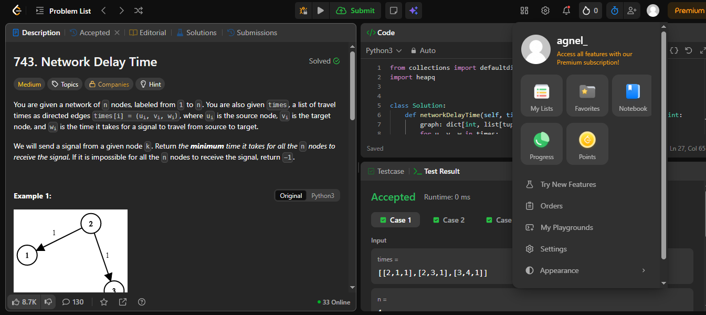

---

## Ejercicio 4 · [1584. Min Cost to Connect All Points](https://leetcode.com/problems/min-cost-to-connect-all-points/)

**Autor:** Maria Alejandra Rua Monsalve (`Alejandra-Rua`)  
**Dificultad:** Medium  
**Familia:** grafos (árbol de expansión mínima, algoritmo de Prim)  
**Idea:** Utilizar el algoritmo de Prim para conectar todos los puntos con el menor costo posible. Se comienza desde un punto y, en cada iteración, se selecciona el punto no visitado con la menor distancia de Manhattan hacia el conjunto de puntos ya conectados. Se actualizan las distancias mínimas de los demás puntos y se acumula el costo de cada conexión. El proceso termina cuando todos los puntos están conectados, sin formar ciclos.  
**Complejidad:** Tiempo $O(n^2)$ y espacio extra $O(n)$, donde $n$ es el número de puntos.

## Enunciado
Dado un arreglo `points`, donde `points[i] = [xi, yi]` representa las coordenadas de un punto en el plano, se debe encontrar el **costo mínimo para conectar todos los puntos**. El costo de conectar dos puntos corresponde a su **distancia de Manhattan**, calculada como $|x_1-x_2|+|y_1-y_2|$. Todos los puntos deben quedar conectados mediante un único camino entre cada par.

## Evidencias

### Accepted
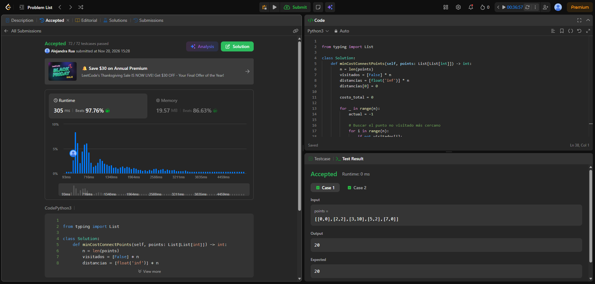

### Runtime
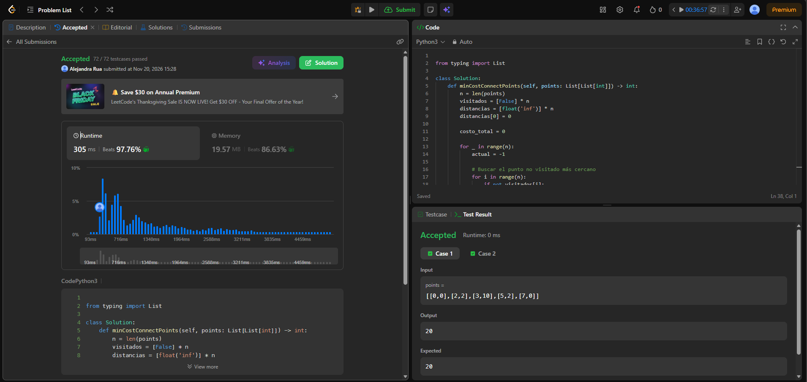

### Memory
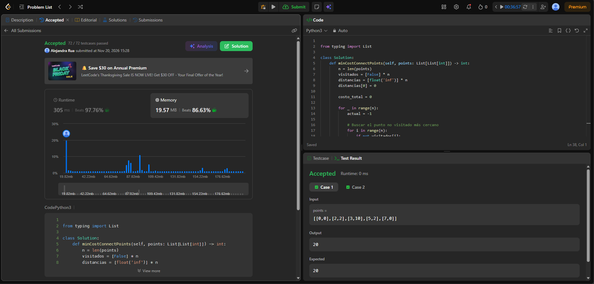

---

## Ejercicio 5 · [72. Edit Distance](https://leetcode.com/problems/edit-distance/)

**Autor:** Maria Alejandra Rua Monsalve (`Alejandra-Rua`)  
**Dificultad:** Medium  
**Familia:** programación dinámica  
**Idea:** Construir una matriz `dp` donde cada posición `dp[i][j]` representa el número mínimo de operaciones necesarias para transformar los primeros `i` caracteres de `word1` en los primeros `j` caracteres de `word2`. Si los caracteres coinciden, se conserva el resultado diagonal anterior. Si son diferentes, se selecciona el menor costo entre insertar, eliminar o reemplazar un carácter, sumando una operación. El resultado se encuentra en la última posición de la matriz.  
**Complejidad:** Tiempo $O(m \times n)$ y espacio $O(m \times n)$, donde $m$ y $n$ son las longitudes de las dos palabras.

## Enunciado
Dadas dos cadenas de texto `word1` y `word2`, se debe calcular el **número mínimo de operaciones necesarias para convertir `word1` en `word2`**. Las operaciones permitidas son **insertar, eliminar o reemplazar** un carácter. Por ejemplo, transformar `"horse"` en `"ros"` requiere `3` operaciones.

## Evidencias

### Accepted

### Runtime
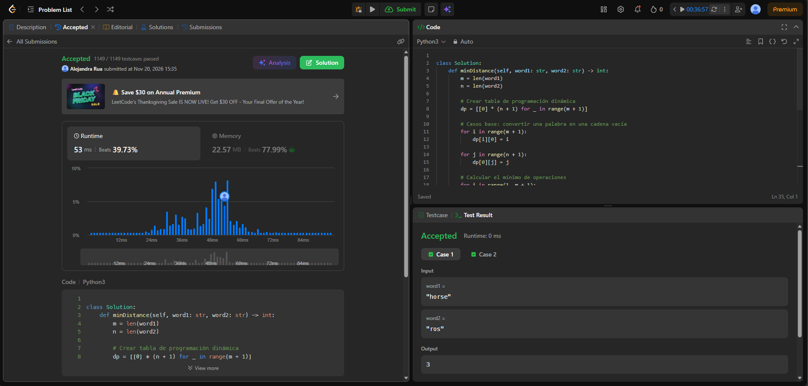

### Memory
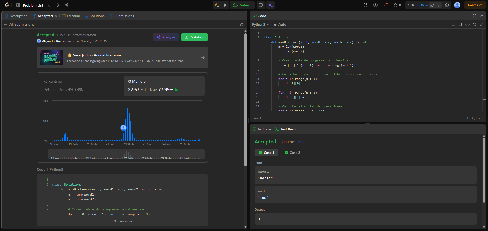

---

## Ejercicio 6 · [300. Longest Increasing Subsequence](https://leetcode.com/problems/longest-increasing-subsequence/)

**Autor:** Maria Alejandra Rua Monsalve (`Alejandra-Rua`)  
**Dificultad:** Medium  
**Familia:** programación dinámica  
**Idea:** Utilizar un arreglo `dp` donde `dp[i]` representa la longitud de la subsecuencia estrictamente creciente más larga que termina en la posición `i`. Inicialmente, cada elemento forma una subsecuencia de longitud `1`. Para cada posición, se revisan los elementos anteriores y, si alguno es menor que el actual, se actualiza la longitud máxima utilizando `dp[j] + 1`. Finalmente, se devuelve el valor máximo del arreglo `dp`.  
**Complejidad:** Tiempo $O(n^2)$ y espacio extra $O(n)$, donde $n$ es la cantidad de elementos del arreglo.

## Enunciado
Dado un arreglo de enteros `nums`, se debe encontrar la **longitud de la subsecuencia estrictamente creciente más larga**. Una subsecuencia se obtiene eliminando cero o más elementos sin alterar el orden de los restantes. Por ejemplo, para `[10,9,2,5,3,7,101,18]`, una subsecuencia creciente es `[2,3,7,101]`, cuya longitud es `4`.

## Evidencias

### Accepted
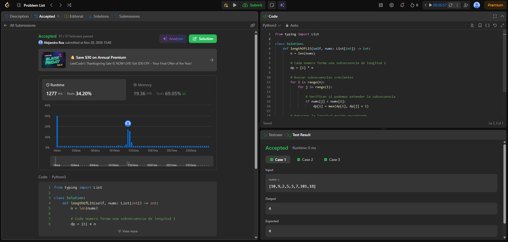

### Runtime

### Memory
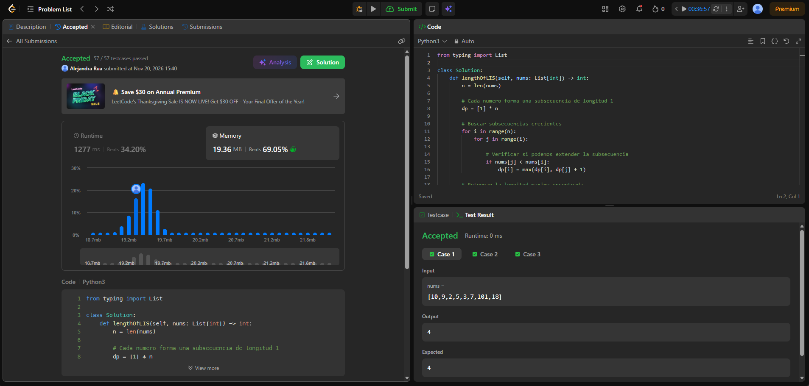

---

## Ejercicio 7 · [134. Gas Station](https://leetcode.com/problems/gas-station/)

**Autor:** Sergio Esteban Franco Agudelo (`sergiofranko`)  
**Dificultad:** Medium  
**Familia:** greedy  
**Idea:** Utilizar un enfoque *greedy* de una sola pasada manteniendo el balance neto de combustible (`gas[i] - cost[i]`), un acumulado global (`total_tank`), un tanque parcial (`current_tank`) y un índice candidato de inicio (`start = 0`). Al recorrer cada estación, se suma el balance neto a ambos tanques; si `current_tank` cae por debajo de `0`, ninguna estación entre `start` y la posición actual `i` puede ser el punto de partida válido, por lo que se reinicia `current_tank` a `0` y se actualiza `start = i + 1`. Finalmente, si `total_tank` es mayor o igual a `0`, se devuelve `start`; de lo contrario, se devuelve `-1`.  
**Complejidad:** Tiempo $O(n)$ y espacio extra $O(1)$, donde $n$ es la cantidad de estaciones de gasolina.

## Enunciado
Hay `n` estaciones en un circuito. En la `i` hay `gas[i]` unidades y viajar de `i` a la siguiente cuesta `cost[i]`. El tanque empieza vacío. Hay que devolver el **índice** desde el que se puede dar **una** vuelta completa. Si no existe, `-1`. Si existe, es único.
El criterio local no es «la estación con más gas». Es un acumulado que no se retracta: si el tanque se vacía al intentar salir desde un tramo, **ninguna** estación de ese tramo sirve de inicio, y el siguiente candidato es la estación de justo después.

## Evidencias

### Accepted + Memory
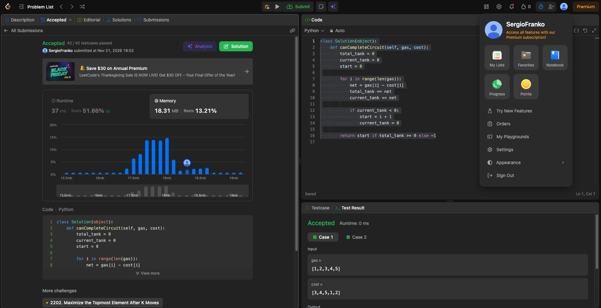

### Accepted + Runtime
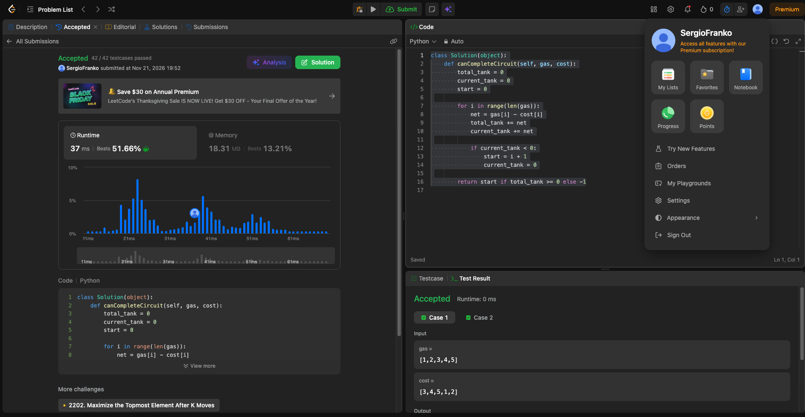

---

## Ejercicio 8 · [79. Word Search](https://leetcode.com/problems/word-search/)

**Autor:** Sergio Esteban Franco Agudelo (`sergiofranko`)  
**Dificultad:** Medium  
**Familia:** backtracking  
**Idea:** Utilizar búsqueda en profundidad (*DFS*) con *backtracking* recorriendo cada celda de la matriz `board` como posible punto de partida cuando coincide con la primera letra de `word`. En cada paso recursivo, se valida que la celda esté dentro de los límites y coincida con el carácter actual, se marca temporalmente como visitada modificando su valor en el lugar (por ejemplo, a `'#'`) para evitar reutilizarla, y se exploran las cuatro direcciones adyacentes (arriba, abajo, izquierda y derecha). Si ningún camino completa la palabra, se restaura el carácter original al retroceder; si se alcanzan todos los caracteres de `word`, se devuelve `True`.  
**Complejidad:** Tiempo $O(m \cdot n \cdot 3^L)$ y espacio extra $O(L)$, donde $m$ y $n$ son las dimensiones de la matriz y $L$ es la longitud de `word` (correspondiente a la profundidad máxima de la pila de recursión).

## Enunciado
Hay una grilla de letras y una palabra `word`. Decidir si la palabra aparece en celdas **adyacentes** en horizontal o vertical (no en diagonal). La misma celda no se puede usar dos veces en la misma palabra.
En Combination Sum (taller de octubre) se elegía un candidato, se bajaba el resto y se **deshacía** la elección. Aquí el candidato es una celda vecina. Greedy de «seguir la primera letra que coincida» se mete en un callejón y no prueba el otro vecino. Hay que marcar, seguir, y al volver **quitar la marca**.

## Evidencias

### Accepted + Memory
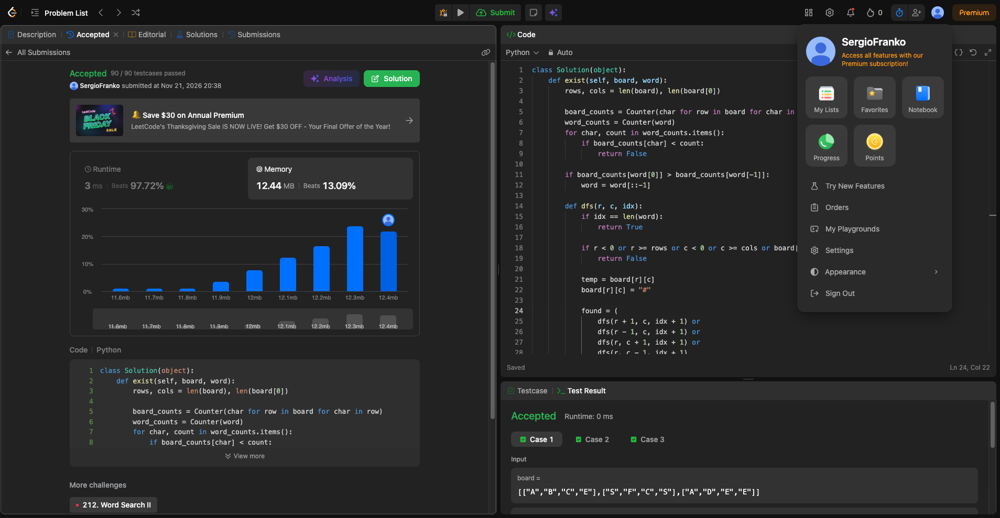

### Accepted + Runtime
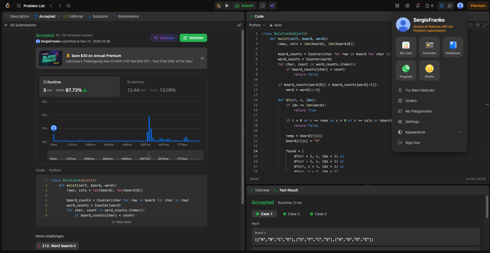
