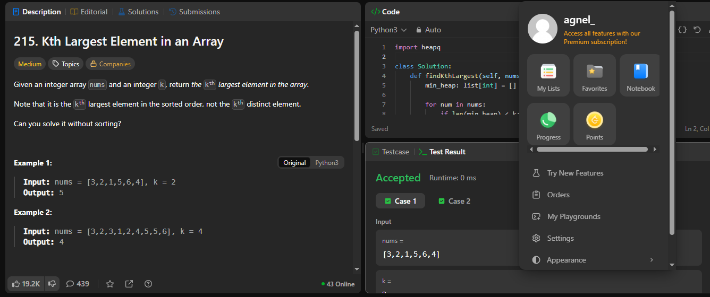
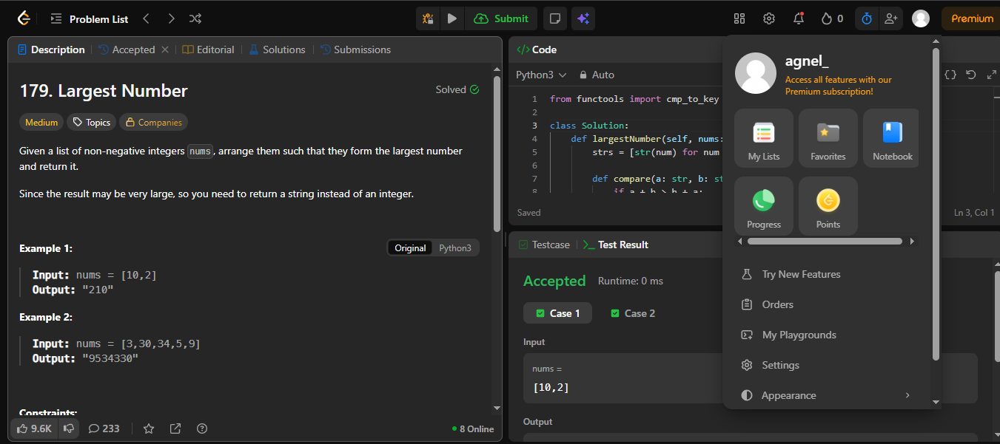

# Tabla de autoría

| Integrante | Usuario de git | Ejercicios |
| --- | --- | --- |
| Sebastian Espinosa Hernández | sebasespinosa18 | 215, 179, 743 |
| Sergio Esteban Franco Agudelo | sergiofranko | 134, 79 |
| Maria Alejandra Rua Monsalve | Alejandra-Rua | 1584, 72, 300 |

## Ejercicio 1 · [215. Kth Largest Element in an Array](https://leetcode.com/problems/kth-largest-element-in-an-array/)

**Autor:** Sebastian Espinosa (`sebasespinosa18`)  
**Dificultad:** Medium  
**Familia:** heap
**Idea:** Mantener un min-heap con a lo sumo `k` elementos que represente los `k` mayores valores encontrados hasta el momento. Si llega un elemento mayor que la raíz (el mínimo del top `k`), se reemplaza la raíz por el nuevo valor; al terminar, la raíz es el k-ésimo mayor. No se ordena todo el arreglo.  
**Complejidad:** Tiempo $O(n \log k)$ y espacio extra $O(k)$, donde $n$ es el tamaño de `nums`.

## Enunciado
Dado `nums` y un entero `k`, devolver el **k-ésimo mayor**. Es el mayor del arreglo si `k = 1`, el segundo mayor si `k = 2`, y así.

## Evidencias

---

## Ejercicio 2 · [179. Largest Number](https://leetcode.com/problems/largest-number/)
**Autor:** Sebastian Espinosa (`sebasespinosa18`)  
**Dificultad:** Medium  
**Familia:** ordenamiento
**Idea:** Pasar los números a cadena y ordenarlos con un comparador por concatenación donde `a` va antes que `b` si `a + b > b + a`. Al final unir todo y devolver `"0"` si empieza con `"0"` (como en `[0, 0]`).
**Complejidad:** Tiempo $O(n \log n)$ comparaciones (cada una lineal en la longitud de las cadenas) y espacio $O(n)$ para las cadenas y la salida.

## Enunciado
Dado un arreglo de enteros no negativos, hay que permutarlos y **concatenarlos** para formar el **mayor número** posible. La respuesta es ese número como cadena. `[10, 2]` da `"210"`, no `"102"`.

## Evidencias

